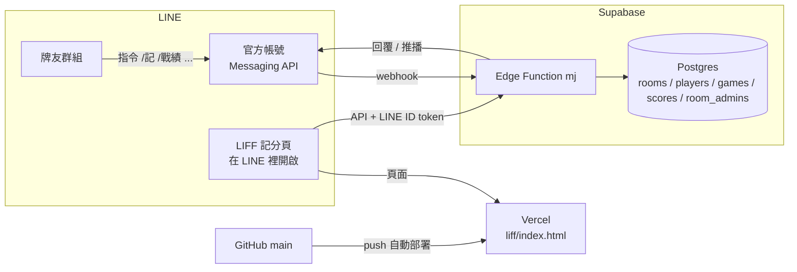

# 麻將計分 LINE 版

LINE 群組 Bot ＋ LIFF 記分頁。管理員在群組裡用指令或記分頁記分，Bot 把結果和排行回到群組；其他牌友不用加好友，想看個人戰績的人再到記分頁「認領」自己的名字。

> 分數只作為遊戲紀錄，不具任何金錢價值。

---

## 架構



| 元件 | 負責什麼 | 程式位置 |
|---|---|---|
| **LINE 官方帳號（Messaging API）** | 群組裡收指令、回覆、推播 | — |
| **LINE Login channel + LIFF** | 記分頁在 LINE 裡打開、取得使用者身分 | — |
| **Supabase Edge Function `mj`** | Bot webhook ＋ 記分頁用的 API | `supabase/functions/mj/` |
| **Supabase Postgres** | 存房間、玩家、對局、管理員 | `supabase/migrations/` |
| **Vercel** | 放記分頁（純靜態，只發佈 `liff/`） | `liff/index.html`、`vercel.json` |
| **GitHub** | 原始碼；推到 `main` 會觸發 Vercel 部署 | 這個 repo |

### 線上服務一覽

| 項目 | 值 |
|---|---|
| GitHub repo | `yuxing-lee/mahjong`（分支 `main`） |
| 本機資料夾 | `C:\Users\user\Desktop\Side Project\majong-line` |
| Supabase 專案 | `majong-line`，ref `hofjzjhqizukceosjufr`（Singapore） |
| Edge Function | `mj`（**Verify JWT 關閉**） |
| Webhook URL | `https://hofjzjhqizukceosjufr.supabase.co/functions/v1/mj/webhook` |
| 記分頁 API | `https://hofjzjhqizukceosjufr.supabase.co/functions/v1/mj/api` |
| 記分頁網址（Vercel） | `https://mahjong-gold-ten.vercel.app` |
| LINE Provider | `AI助手` |
| LIFF ID | `2011866186-iudTebek`（LIFF URL：`https://liff.line.me/2011866186-iudTebek`） |

### Supabase Secrets（Edge Functions → Secrets）

| 名稱 | 從哪裡拿 |
|---|---|
| `LINE_CHANNEL_SECRET` | Messaging API channel → Basic settings → Channel secret |
| `LINE_CHANNEL_ACCESS_TOKEN` | Messaging API channel → Messaging API 分頁最下面 → Channel access token (long-lived) |
| `LINE_LOGIN_CHANNEL_ID` | **LINE Login channel**（LIFF 所在的那個）→ Basic settings → Channel ID |
| `LIFF_ID`（選填） | 沒設的話程式預設用 `2011866186-iudTebek` |

`SUPABASE_URL`、`SUPABASE_SERVICE_ROLE_KEY` 由 Supabase 自動提供，不用設。在 Supabase 上程式會自動使用資料庫；`STORE` 只有本機測試才需要。

**這些值不要放進 repo、也不要截圖外流。** 外流的話到 LINE Developers 按 Issue 重新產生，再更新 Secrets。

---

## 群組指令

| 指令 | 誰能用 | 說明 |
|---|---|---|
| `/開房 週五麻將` | 任何人（建的人＝房主） | 把群組設成計分房 |
| `/加人 小明 阿華 老王 阿美` | 管理員 | 加玩家（名字不能有數字、`+`、`-`） |
| `/記 小明+100 阿華-30 老王-70` | 管理員 | 記一場，總和必須是 0（也接受「小明 100 阿華 -30」和全形數字） |
| `/戰績` | 所有人 | 排行榜卡片（附「開啟記分頁」按鈕） |
| `/最近` | 所有人 | 最近 5 場 |
| `/分析 名字` | 所有人 | 個人摘要：勝率、近 10 場、最順的同桌、剋星、提款機（不打名字＝看自己，需先認領） |
| `/撤銷` | 管理員 | 刪最後一場 |
| `/刪房` | 管理員 | 刪除房間和所有紀錄（會先要求 `/刪房 確認`） |
| `/設台費 名字`、`/取消台費 名字` | 管理員 | 台費帳戶（例如場主設備錢「東」）照樣記分、照樣出現在排行，但不列入個人分析 |
| `/設管理員 @某人` | 管理員 | 設成管理員（也可以用已認領的名字：`/設管理員 阿華`） |
| `/移除管理員 @某人` | 管理員 | 取消管理員（房主不能被移除） |
| `/管理員` | 所有人 | 列出房主和管理員 |
| `/記分頁` | 所有人 | 取得記分頁連結 |
| `/說明` | 所有人 | 指令列表 |

- Bot 每次回覆會附 **快速回覆按鈕**（戰績／最近／記分頁／撤銷／說明），點了就送出指令。
- 不是 `/` 開頭的訊息 Bot 不回，不會洗版。
- 指令都用「回覆」，**不計入**官方帳號的免費訊息額度；只有在記分頁送出一場時會「主動推播」一則到群組，這會計入額度。
- 記完一場只顯示這一場的結果，不附累計；要看累計請用 `/戰績`。

### 記分頁

- 管理員：記分（即時檢查總和為 0、可「補平」最後一家、**可選日期**補記以前的牌局）、新增玩家、刪除單場、**改某場的日期**（紀錄分頁的「改日期」）
- **兩桌一起記的分數可以拆開**：
  - 記分時：填完分數（4 人以上、總和為 0）會出現「分兩桌記」
  - 已經記成一場的：紀錄分頁按「拆兩桌」
  - 網頁會算出兩桌各自總和為 0 的分法（台費帳戶的錢依兩桌輸贏自動分配，兩桌都不能是負的），依「每桌接近 4 人、兩桌台費接近」排序列出建議；選一個或逐一調整每個人在哪一桌，再確認。只看數字通常有好幾種可能，要選實際的那一種
  - 拆好的兩場備註會加「第1桌」「第2桌」，日期和原本相同
- 所有人：排行、**分析**、累計走勢圖、最近 30 場紀錄、認領自己的名字
- 「分析」分頁：選一位玩家，看概況（勝率、場均、近 10 場、連勝）、和誰同桌最順、剋星與提款機（同桌時的平均分差）、遇到哪一桌（同桌的人完全相同才算同一組）、每月表現。同桌不到 3 場的數字會顯示成灰色
- 網址加 `?demo=1` 進入**試玩模式**：不用登入、不連後端，資料只存在那台裝置

---

## 怎麼改、怎麼部署

### 改記分頁（`liff/index.html`）
推到 GitHub `main` 就好，**Vercel 會自動部署**，LINE 不用改。

```bash
git add liff/index.html
git commit -m "..."
git push origin main
```

### 改 Bot / API（`supabase/functions/mj/`）
推 GitHub **不會**自動更新 Supabase，要另外部署：

```bash
npx supabase login                                   # 第一次才需要
npx supabase functions deploy mj --project-ref hofjzjhqizukceosjufr
```

`supabase/config.toml` 已經把 `mj` 設成 `verify_jwt = false`。如果改從 Supabase 後台部署，記得也要把 **Verify JWT 關掉**，不然 LINE webhook 和記分頁都會被擋（401）。

### 改資料表
1. 在 `supabase/migrations/` 新增一個檔案，例如 `003_xxx.sql`
2. 套用到資料庫，任選一種：
   - Supabase 後台 → SQL Editor 貼上執行
   - `npx supabase link --project-ref hofjzjhqizukceosjufr` 後 `npx supabase db push`

目前的資料表：

| 表 | 內容 |
|---|---|
| `rooms` | 房間；`line_group_id` 綁群組、`admin_line_user_id` 是房主、`code` 是記分頁連結用的房號 |
| `players` | 玩家名字；`line_user_id` 有值代表已被認領 |
| `games` | 每一場 |
| `scores` | 每場每人的分數 |
| `room_admins` | 房主以外的管理員 |

`players.is_house = true` 代表台費帳戶（目前「紅中」房的「東」）。

記一場是透過資料庫函式 `record_game_at()`（可指定日期；舊的 `record_game()` 保留未用），在同一個交易裡再檢查一次「至少兩人、總和為 0、玩家屬於這個房間」。

所有表都開了 RLS 但**沒有 policy**，這是刻意的：網頁不直接連資料庫，所有讀寫都經過 Edge Function（service role）。Supabase 的安全檢查會提示「RLS Enabled No Policy」，可以忽略。

### 改設定值
- Secrets：Supabase → Edge Functions → Secrets，存檔後立即生效，不用重新部署
- 記分頁連到哪個 LIFF / API：`liff/index.html` 最上面的 `LIFF_ID`、`API_BASE`

---

## LINE 設定檢查表

兩個 channel 都在 **`AI助手` Provider** 底下（必須同一個 Provider，userId 才對得上）。

**Messaging API channel（Bot）**
- [ ] Webhook URL = `https://hofjzjhqizukceosjufr.supabase.co/functions/v1/mj/webhook`，**Use webhook** 開啟，Verify 成功
- [ ] Channel secret、long-lived access token 已填進 Supabase Secrets

**官方帳號（manager.line.biz → 設定）**
- [ ] 帳號設定 →「加入群組或多人聊天室」= **接受邀請**（沒開的話 Bot 一進群組就自動退出）
- [ ] 回應設定 →「自動回應訊息」**關閉**

**LINE Login channel**
- [ ] Channel ID 已填進 `LINE_LOGIN_CHANNEL_ID`
- [ ] LIFF `2011866186-iudTebek`：Size **Full**、Scopes 勾 **openid**、**profile**、Endpoint URL = `https://mahjong-gold-ten.vercel.app`

> 新的 Messaging API channel 不能直接在 Developers Console 建立，要先在 manager.line.biz 建官方帳號，再到「設定 → Messaging API」啟用。

---

## 疑難排解

| 狀況 | 原因 / 處理 |
|---|---|
| Bot 加進群組馬上退出 | 官方帳號沒開「接受邀請加入群組」 |
| Webhook Verify 顯示 timeout | 剛改 Secrets 或剛部署時函式在重啟，等幾秒再按一次 |
| Webhook Verify 顯示 401 | `LINE_CHANNEL_SECRET` 錯，或 Verify JWT 沒關 |
| 記分頁顯示「LINE Login Channel ID 設定不符」 | `LINE_LOGIN_CHANNEL_ID` 填成別的 channel 的 ID |
| 記分頁顯示「登入已過期」 | 關掉頁面重新開啟 |
| 記分頁顯示「拿不到 LINE 登入資訊」 | LIFF 的 Scopes 沒勾 `openid` |
| 群組打指令沒反應 | 看 Supabase → Edge Functions → mj → Logs；確認 Use webhook 有開、自動回應有關 |
| 私訊 Bot 只回「請把我加進群組」 | 目前設計是房間綁群組，指令要在群組裡用 |

查紀錄：Supabase 後台 → Edge Functions → `mj` → **Logs** / **Invocations**。

---

## 專案結構

```
.
├─ liff/index.html                    記分頁（單一檔案，內建試玩模式）
├─ vercel.json                        Vercel 只發佈 liff/，不跑 build
├─ deno.json                          dev / test / check 指令
├─ .env.example                       本機測試用的環境變數範本
└─ supabase/
   ├─ config.toml                     CLI 設定（mj 關閉 verify_jwt）
   ├─ migrations/
   │  ├─ 001_init.sql                 rooms / players / games / scores + record_game()
   │  ├─ 002_room_admins.sql          多位管理員
   │  ├─ 003_house_player.sql         台費帳戶（players.is_house）
   │  └─ 004_game_date.sql            record_game_at()：記分時可指定日期
   └─ functions/mj/
      ├─ index.ts                     Bot webhook + 記分頁 API
      ├─ logic.ts                     解析分數、計算戰績、個人分析（純邏輯）
      ├─ store.ts                     儲存介面；在 Supabase 上自動用資料庫，本機預設用 JSON 檔
      ├─ store_supabase.ts            Supabase 實作
      ├─ store_file.ts                JSON 檔實作（本機測試用）
      └─ logic_test.ts / e2e_test.ts  測試
```

### API 路由（都在 `.../functions/v1/mj/` 底下）

| 路由 | 說明 |
|---|---|
| `POST webhook` | LINE webhook（用 Channel secret 驗簽章） |
| `GET api/room?code=房號` | 記分頁讀資料 |
| `GET api/analysis?code=房號&player=玩家ID` | 個人分析 |
| `POST api/game` | 記一場（管理員，可帶 `played_at` 補記日期），成功後推播到群組 |
| `POST api/game/delete` | 刪一場（管理員） |
| `POST api/game/date` | 改某場的日期（管理員） |
| `POST api/game/split` | 把一場拆成兩桌（管理員；檢查分數對得上後新增兩場、刪掉原本那場） |
| `POST api/player` | 加玩家（管理員） |
| `POST api/claim` | 認領名字 |
| `GET health` | 健康檢查 |

`api/*` 需要 `Authorization: Bearer <LINE ID token>`，由記分頁的 LIFF SDK 自動帶入。

---

## 本機開發

需要 [Deno 2](https://deno.com)。

```bash
deno task test            # 單元測試 + 端到端測試（不連 LINE、不連 Supabase）
deno task check           # 型別檢查
```

想在本機跑一個完整的 Bot（資料存在 `./data.json`）：

```bash
cp .env.example .env      # 填 LINE 的值，STORE=file
deno task dev             # http://localhost:8000
cloudflared tunnel --url http://localhost:8000   # LINE 需要 HTTPS
```

再把 LINE 的 Webhook URL 暫時改成 `https://<通道網址>/webhook`、記分頁的 `API_BASE` 改成 `https://<通道網址>/api`。**測完記得改回 Supabase 的網址。**

沒填 `LINE_CHANNEL_ACCESS_TOKEN` 時，Bot 要送的訊息只會印在終端機。

---

## 之後可以加的功能
- 一場拆成多將、底台設定、自動換算
- 記錄胡牌／放槍／自摸／莊家，做「誰放槍給誰」的分析
- 打法風格：穩定度、大勝大敗比例
- 匯出 CSV
- 私訊 Bot 也能記分
